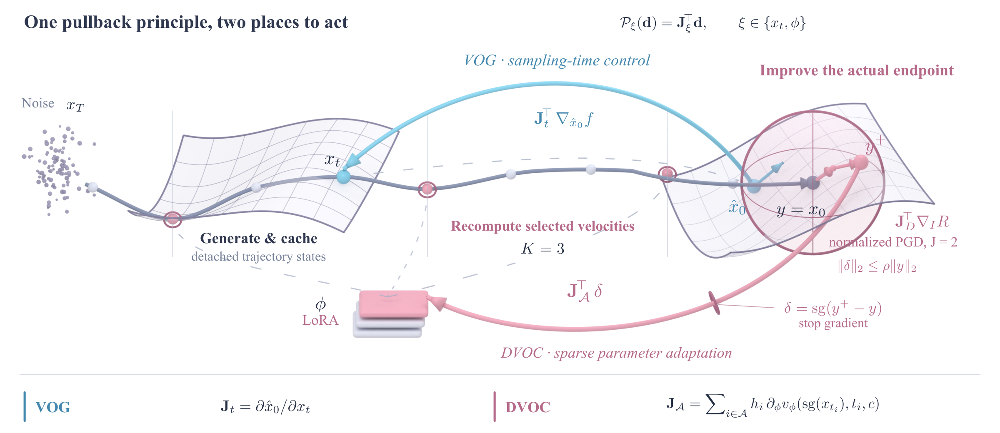
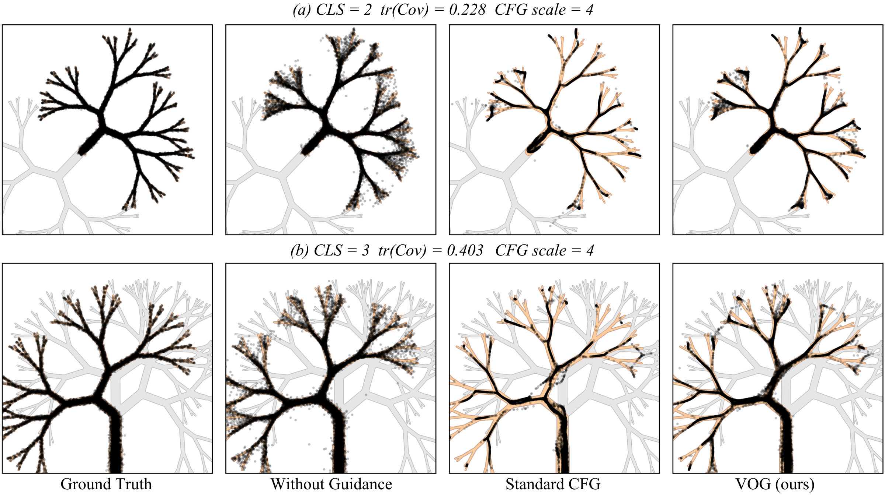
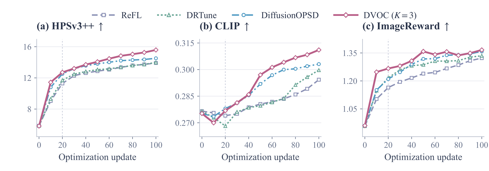

<h1 align="center">VOG</h1>
<h3 align="center">Variational Optimal Control for Diffusion Guidance</h3>

<p align="center">
  <strong>A shared variational principle for diffusion guidance and reward-based adaptation.</strong>
</p>

<p align="center">
  Ruoyu Wang<sup>1,*</sup> &nbsp; Xinyi Ye<sup>1,*</sup> &nbsp; Yunshuo Shi<sup>1,2,*</sup><br>
  Liangyu Yuan<sup>3</sup> &nbsp; Beier Zhu<sup>4</sup> &nbsp; Chi Zhang<sup>1,†</sup>
</p>

<p align="center">
  <sup>1</sup>Westlake University &nbsp; <sup>2</sup>Shandong University<br>
  <sup>3</sup>Shanghai Jiao Tong University &nbsp; <sup>4</sup>University of Science and Technology of China<br>
  <sup>*</sup>Equal contribution &nbsp; <sup>†</sup>Corresponding author
</p>

<p align="center">
  <a href="#overview">Overview</a> ·
  <a href="#method">Method</a> ·
  <a href="#main-results">Results</a> ·
  <a href="#installation">Installation</a> ·
  <a href="#training">Training</a> ·
  <a href="#evaluation">Evaluation</a> ·
  <a href="#todo">TODO</a> ·
  <a href="#citation">Citation</a>
</p>

## Overview

We unify **sampling-time guidance** and **reward-based model adaptation** through variational optimal control. We start from an objective that maximizes terminal reward while penalizing path-space KL divergence from the pretrained conditional process. The Gibbs variational principle yields a reward-weighted distribution over denoising trajectories, and the Doob transform gives the corresponding correction to the generative dynamics.

A local denoising approximation reveals the shared mechanism: **map output preferences back through the Jacobian of the controlled variable**. This yields **Variational Optimal Guidance (VOG)** for sampling states and **Distilled Variational Optimal Control (DVOC)** for model parameters. VOG steers the current sample, while DVOC distills locally improved endpoints into the generator so that future samples incorporate the control.

<p align="center">
  
</p>
<p align="center"><em>VOG corrects the current sampling state. DVOC refines the sampled endpoint and distills the fixed target into model parameters.</em></p>

| ImageNet guidance | Generation in 25 steps | Adaptation in 20 updates |
|:---:|:---:|:---:|
| Lower FID in **12 / 12** settings | **7.58 → 4.44** FID | **6.72 → 13.79** HPSv3++ |
| Across model–guidance pairings | DiT-XL/2 at 256×256 | Z-Image-Turbo with DVOC |

## Method

The local control rule translates a desired output improvement into an update through the corresponding Jacobian. Choosing the controlled variable gives the two methods:

| Method | Controlled variable | How the improvement is applied |
|---|---|---|
| **VOG** | Current sampling state | Pull the reward gradient back through the denoising Jacobian to obtain a guidance correction. |
| **DVOC** | Model parameters | Refine the generated endpoint and distill its displacement through the parameter Jacobian. |

### VOG: control the sampling state

VOG evaluates the objective on the denoised prediction and maps its gradient back to the current noisy state. The correction therefore accounts for how a change in that state affects the predicted clean sample. Under the linear MMSE subspace model, the exact VOG correction lies in the data subspace, giving a geometric interpretation of the guidance rule.

### DVOC: learn the control in model parameters

Each training update has three steps:

1. **Sample.** Generate a trajectory with the current model and cache its states and velocities.
2. **Improve the endpoint.** Refine the final latent with projected reward ascent inside a bounded neighborhood of the sampled endpoint. The refined latent becomes a fixed training target.
3. **Distill.** Fit the target with LoRA, passing parameter gradients through velocity evaluations at selected cached states. The distillation gradient maps the target displacement back to the model parameters, realizing the same local control rule.

The default recipe uses **nine Euler steps**, **K=3 active states**, **J=2 target-ascent steps**, and a **relative target radius of 0.1**. After adaptation, the model generates images with the standard nine-step sampler. See [Algorithm](docs/algorithm.md) for the objective and its implementation.

## Main Results

### ImageNet generation

VOG improves FID across **all twelve** evaluated combinations of model, resolution, and guidance baseline. Each `+ VOG` row adds the correction to the baseline directly above it. FID is measured on 50,000 generated images. Lower is better, and **bold** marks the best result in each column.

| Guidance | EDM2-S 512² | DiT-XL/2 256² | EDM2-L 64² | DiT-XL/2 512² |
|---|---:|---:|---:|---:|
| CFG | 2.29 | 2.27 | 1.99 | 3.04 |
| **CFG + VOG** | 2.03 | 2.04 | **1.42** | 2.89 |
| Interval | 1.87 | 1.97 | 1.64 | 2.41 |
| **Interval + VOG** | **1.67** | **1.94** | 1.52 | **2.39** |
| Cosine | 2.15 | 2.30 | 1.67 | 3.48 |
| **Cosine + VOG** | 2.06 | 2.03 | 1.65 | 2.83 |

The improvement also holds with fewer sampling steps. At 256×256 resolution and **25 steps**, VOG reduces DiT-XL/2 FID from **7.58 to 4.44** and SiT-XL/2 FID from **6.20 to 3.89**.

### Preserving distribution coverage

<p align="center">
  
</p>

On the branching-tree distributions, VOG retains more branches while suppressing off-target samples. Compared with CFG, recall increases from **0.876 to 0.957** in the two-class setting and from **0.779 to 0.933** in the three-class setting.

### Reward alignment on Z-Image-Turbo

DVOC raises Z-Image-Turbo's HPSv3++ score from **6.72 to 13.79 in 20 updates**. The comparison below evaluates all adapted models at update 20 on the same 1,000 prompts and initial noise, with 1024×1024 images and nine Euler steps. Z-Image-Turbo is the pretrained reference. Higher is better for every metric, and **bold** marks the best result in each column.

| Method | HPSv3++ ↑ | CLIP ↑ | Q-Align Q. ↑ | Q-Align A. ↑ | AES ↑ | ImageReward ↑ | DeQA ↑ |
|---|---:|---:|---:|---:|---:|---:|---:|
| Z-Image-Turbo | 6.72 | 0.2757 | 4.825 | 3.533 | 5.412 | 0.959 | **4.439** |
| ReFL | 12.22 | 0.2744 | 4.844 | 4.223 | 5.955 | 1.159 | 4.133 |
| DRTune | 12.70 | 0.2688 | 4.932 | 4.489 | 6.095 | 1.225 | 4.262 |
| DiffusionOPSD | 13.56 | **0.2782** | 4.886 | 4.452 | 6.101 | 1.196 | 4.014 |
| **DVOC (K=3)** | **13.79** | 0.2765 | **4.943** | **4.618** | **6.288** | **1.279** | 4.237 |

Among the compared methods, DVOC achieves the highest HPSv3++ score and leads on four held-out metrics: **Q-Align quality, Q-Align aesthetics, AES, and ImageReward**.

<p align="center">
  
</p>
<p align="center"><em>Online evaluation of EMA checkpoints over 100 updates. Markers show checkpoint means, and the dashed line marks update 20.</em></p>

## TODO

- [x] DVOC training and evaluation code.
- [x] Reference configurations, prompt lists, and paired sampling plans.
- [ ] Release VOG code for inference-time guidance.

## Installation

The training setup uses **Python 3.10+**, **PyTorch 2.6+**, and **CUDA on Linux**.

```bash
cd vog
python -m venv .venv
source .venv/bin/activate
python -m pip install -e '.[hps,evaluation]'
python -m pip install --no-deps image-reward
python -m pip check
```

Set the model and reward paths in [`configs/environment.example.sh`](configs/environment.example.sh), then load them:

```bash
source configs/environment.example.sh
```

Set `model.path` in the training configuration to your Z-Image-Turbo directory or model ID. For HPSv3++, configure the source directory, reward checkpoint, inference configuration, and Qwen3-VL backbone in the environment file. Reward loaders also support local models under `DVOC_MODEL_ROOT/<organization>/<model>`.

## Training

Run DVOC through the `dvoc` command or Python module. Validate the configuration and launch training on eight GPUs:

```bash
dvoc check --config configs/endpoint_j2.json --world-size 8 --models

torchrun --standalone --nproc_per_node=8 -m dvoc train \
  --config configs/endpoint_j2.json
```

The default run trains a **rank-32 LoRA adapter** for **20 updates** using the reward `0.03846 × HPSv3++ + CLIP`. Each GPU samples 72 trajectories per update, giving a global batch of 576. Optimization uses AdamW with learning rate `3e-4` and weight decay `1e-4`.

| Configuration | Target | Ascent steps J | Active states K |
|---|---|---:|---:|
| [`endpoint_j2.json`](configs/endpoint_j2.json) | Sampled endpoint | 2 | 3 |
| [`endpoint_j1.json`](configs/endpoint_j1.json) | Sampled endpoint | 1 | 3 |
| [`proxy_j2.json`](configs/proxy_j2.json) | Late-state clean prediction | 2 | 3 |

These configurations override the defaults in [`src/dvoc/config.py`](src/dvoc/config.py). Paths in the supplied configurations resolve from the repository root. The data includes **25,415 training prompts**, **1,000 evaluation prompts**, and an eight-rank paired sampling plan. See [Data](data/README.md) for details.

For a different GPU count, generate a matching plan and set `data.paired_plan` to its path:

```bash
dvoc plan --config configs/endpoint_j2.json --world-size 1 \
  --images-per-prompt 3 --output data/one_gpu_plan.json
```

### Resume training

```bash
torchrun --standalone --nproc_per_node=8 -m dvoc train \
  --config configs/endpoint_j2.json \
  --resume /path/to/checkpoint-10 \
  --output /path/to/new-run
```

`total_updates` counts updates from the beginning of training. A run with `total_updates=20` resumed from checkpoint 10 performs ten more updates. Each checkpoint stores the training adapter in `raw_lora/`, the EMA adapter in `lora/`, optimizer and EMA states, and per-rank random states. To start a new run from an existing adapter, set `model.initial_adapter`.

## Evaluation

Evaluation generates images for the fixed set of **1,000 prompts** and reports **HPSv3++, CLIP, AES, ImageReward, Q-Align quality, Q-Align aesthetics, and DeQA**.

Install Q-Align and DeQA in a separate environment:

```bash
python -m venv .venv-quality
.venv-quality/bin/python -m pip install -r requirements/quality-evaluation.txt
.venv-quality/bin/python -m pip install --no-deps -e .
```

Set `QALIGN_MODEL_PATH` and `DEQA_MODEL_PATH` in the environment file. Then run the evaluation command from the training environment:

```bash
dvoc evaluate --config configs/endpoint_j2.json \
  --adapter /path/to/checkpoint-20/lora \
  --output /path/to/evaluation \
  --gpus 8 --qa-python "$PWD/.venv-quality/bin/python"
```

The command launches GPU workers for generation and scoring. Add `--resume` to continue an interrupted evaluation. Outputs include per-image scores in `report/per_image.csv`, aggregate metrics in `report/summary.json`, and an image manifest. See [Evaluation](docs/evaluation.md) for individual generation and scoring commands.

## Logging

Training writes local JSONL logs and uses W&B in offline mode by default. To enable online tracking:

```bash
wandb login
WANDB_MODE=online WANDB_PROJECT=vog \
  torchrun --standalone --nproc_per_node=8 -m dvoc train \
  --config configs/endpoint_j2.json
```

Use `tracking.group` to group related runs, or set `tracking.backend` to `jsonl` for local logging.

## Repository structure

```text
vog/
├── assets/                  # Method diagram and experimental figures
├── configs/                 # Training configurations and model paths
├── data/                    # Prompt lists and paired sampling plans
├── docs/                    # Algorithm, evaluation, and reproducibility
├── requirements/            # Quality-evaluation environment
└── src/dvoc/
    ├── algorithm/           # Target optimization and distillation loss
    ├── models/              # Z-Image sampling and decoding
    ├── rewards/             # Reward models
    ├── training/            # LoRA training, checkpoints, and logging
    └── evaluation/          # Image generation, scoring, and reports
```

## Citation

If you find this work useful, please cite:

```bibtex
@misc{wang2026variationaloptimalcontroldiffusion,
      title={Variational Optimal Control for Diffusion Guidance}, 
      author={Ruoyu Wang and Xinyi Ye and Yunshuo Shi and Liangyu Yuan and Beier Zhu and Chi Zhang},
      year={2026},
      eprint={2610.37146},
      archivePrefix={arXiv},
      url={https://arxiv.org/abs/2610.37146}, 
}
```

Thanks to the authors of the open-source projects listed in our [acknowledgments](NOTICE.md).
